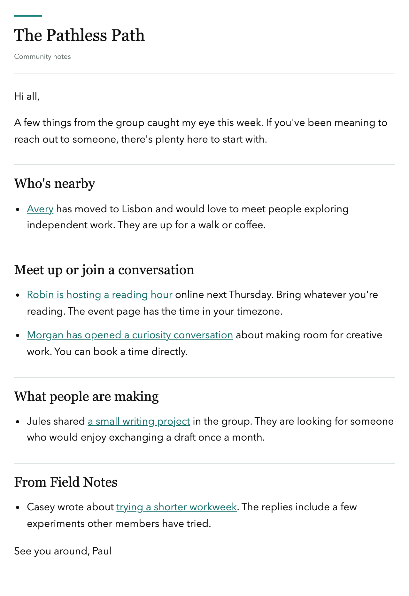
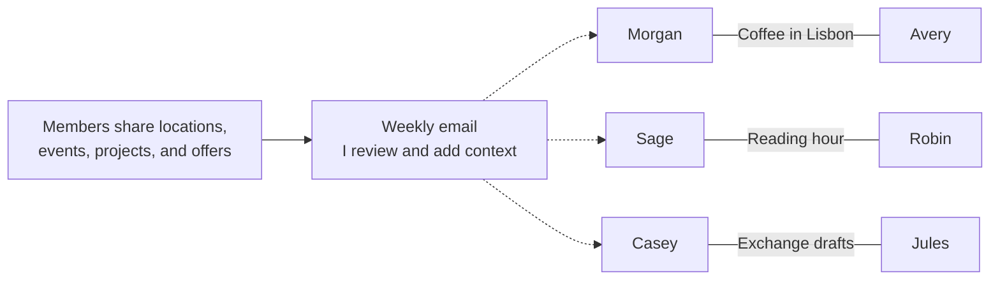
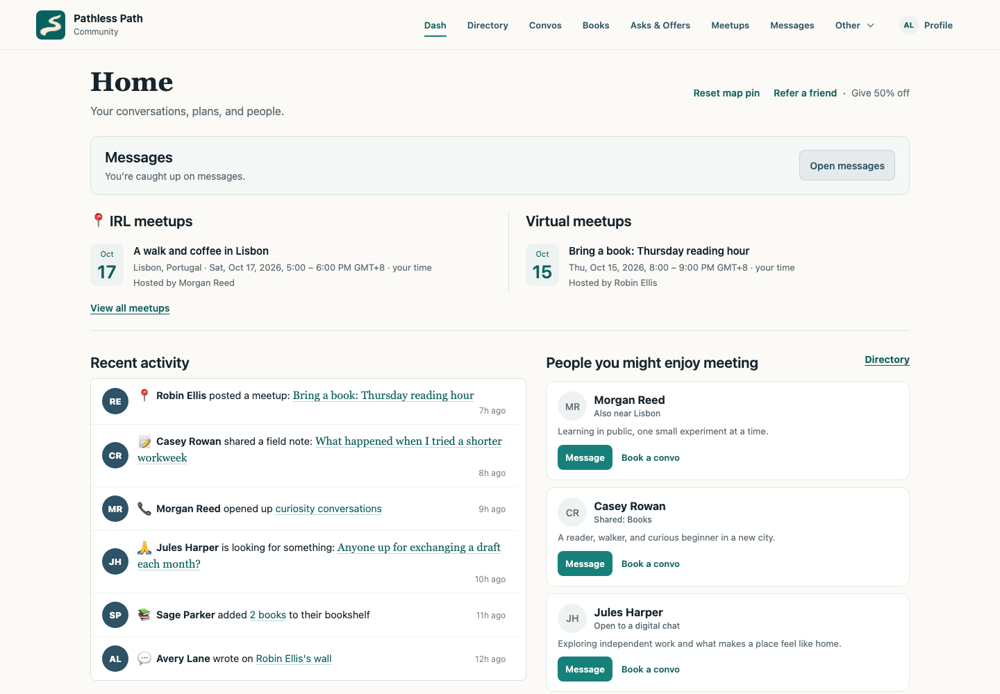
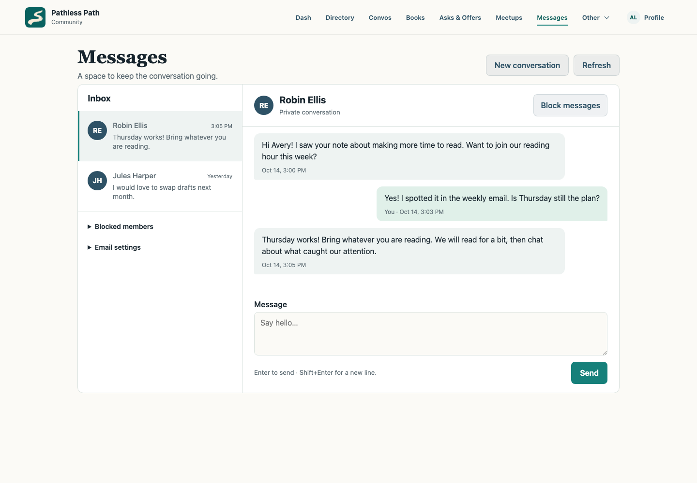
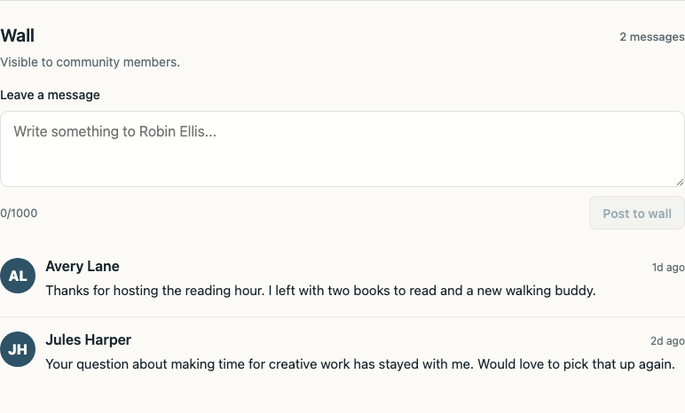
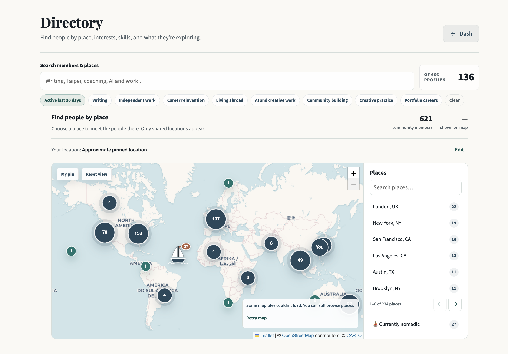
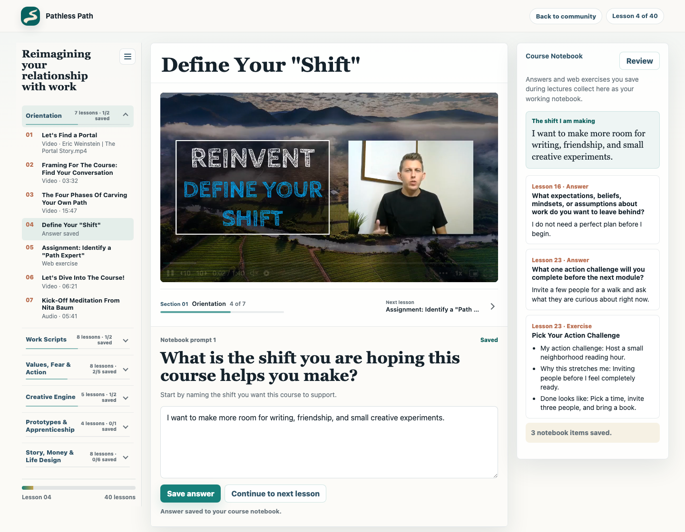
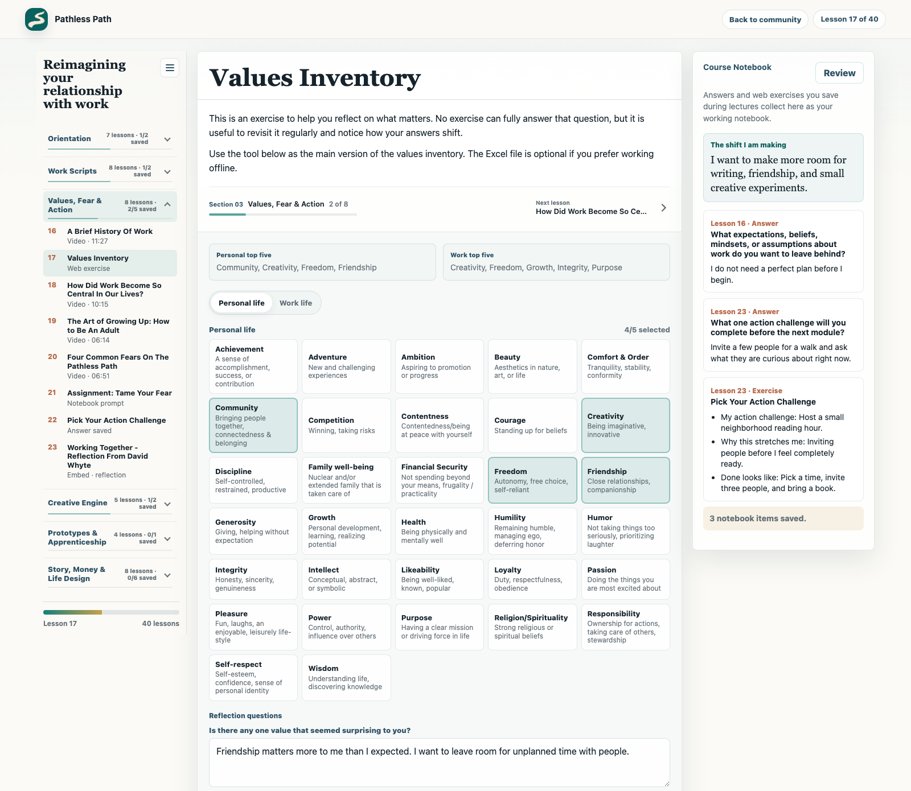

# Circle to self-hosted community stack

Build a community platform you control. This repo shares the Circle migration tools, database schema, and implementation guides behind my [Pathless Path Community](https://community.pathlesspath.com).

I built it to help people find one another: someone nearby, someone asking a similar question, someone to make something with. I pay about **$25.38 a month** for Cloudflare and Resend combined.

The repo includes a working migration toolkit and guides for building your own app. The production interface, authentication, email sender, and course content are not included. Here, self-hosted means you control the application and data in your own provider accounts; my setup runs on managed Cloudflare services.

[Start with the migration guide](docs/migrate-from-circle.md) · [Add a course portal](docs/course-portal.md) · [Review production practices](docs/best-practices.md)

## The weekly email helps people find each other

Each week, the platform gathers member activity: new locations, links shared in the group, projects, conversation offers, and upcoming events. I review the draft, choose what to include, and add a personal introduction. The result is a letter I craft for this community, with direct links that make it easy to follow up.

In [Rolling my own community](https://newsletter.pathlesspath.com/p/rolling-my-own-community-328), I described the information I wanted to surface:

> "what people are doing, what they are sharing, and who they might want to connect with."

A conversation offer can disappear in a busy chat. A useful link can go unread. The email gives these things another chance to reach someone who cares. A member notices a neighbor, joins a reading hour, or finds a person to exchange drafts with. I don't have to arrange every introduction.

That's the magic for me: more is happening with less of my hands-on support. Most of the value is accruing beyond the platform itself.



This example uses the actual weekly email template with fictional names and activity. [How I collect, edit, and send the weekly letter](docs/weekly-member-signals.md).

### From an update to a connection

The email makes people easier to notice. They decide what happens next. These fictional examples show the kinds of connections it can help start:



## What is here

The screenshots show the platform these guides grew out of. Member profiles, messages, activity, and course answers are fictional examples. The map is from my community and shows aggregate locations without member names.

### A homepage with a community feed

See what people are sharing, find a gathering, and discover someone you might enjoy meeting.



### Direct messages

Send someone a note and keep the conversation going. Members can manage message notifications and block unwanted contact.



### A wall on each profile

Leave a message that other community members can see: a thank-you, a follow-up, or a reason to reconnect.



### A map to find people nearby

Browse by city or explore the map. Members choose whether to share their location.



### Courses with video and a notebook

Watch a lesson, move through the course, and keep reflections alongside it. This capture includes an actual Reinvent course video and a fictional learner's answer.



### Exercises people can work through

The values inventory lets learners choose what matters in their personal and working lives, then reflect on the choices. A course can include tools like this alongside video lessons.



[See the full gallery](docs/screenshots.md), including the directory, curiosity conversations, shared bookshelf, and notebook review. The [course portal guide](docs/course-portal.md) covers access, video, progress, and private notes.

## A note from Paul

If you are finding this and looking for the final encouragement to build your own platform, here you go. You can do it. I believe in you. I am giving you permission.

I think building your own platforms is very important to being able to serve people digitally. Standardized online platforms flatten our experiences. Creating your own weird portal can help you stay energized about the people you want to connect with, and help you do interesting things in a cheap or simple way.

I always wanted a community where the most important thing was connecting the nodes inside it. I wasn't trying to build a top-down thing for me to sell and monetize. I wanted to help people find the others.

That shaped the features. As I explain in [the newsletter](https://newsletter.pathlesspath.com/p/rolling-my-own-community-328), I wanted more ways for members to connect and more reasons for them to feel encouraged on their own paths. Travel plans help people meet in person. Curiosity conversations give an open invitation a lasting home. Field Notes make space for slower contributions.

## Want to build your own?

Here's my suggested approach:

1. Email Circle, or whatever platform you're using, and ask for your community's data.
2. Give Codex or Claude Code access to the export in a private workspace. Ask it to build a community and to ask you questions about what you actually want: how people should connect, which features matter, and the designs or templates you like.
3. See if it excites you. If it does, keep building and try it with a few members. Think about cancelling the old platform once the new one works.

You can start with this prompt:

```text
I want to build my own community platform using this export. Ask me questions
one at a time about the community I want to create, how I want people to
connect, the features I care about, and designs or templates I like.

Then help me build a small local prototype I can try. Keep the real member
data private and use fictional people in demos and screenshots. Help me
figure out what needs to work before I invite members or cancel my old platform.
```

## What it costs me

In October 2026, I pay about **$5.38 per month for Cloudflare** and **$20 per month for Resend**: roughly **$25.38 combined**.

Those are my costs for those two services. Your usage will differ; budget separately for domains, video hosting, payment processing, and maintenance.

## What you can build with this repo

| Start here | What it provides |
| --- | --- |
| [Circle migration guide](docs/migrate-from-circle.md) | Export, import, reconcile, and move members in stages |
| [Migration scripts](scripts/) and [sample exports](examples/circle-export/) | A working local rehearsal with fictional data |
| [Community schema](schema/community.sql) | Portable SQLite/D1 tables for members, access, profiles, and preferences |
| [Architecture](docs/architecture.md) and [production practices](docs/best-practices.md) | Hosting, sign-in, privacy, billing, email, and recovery guidance |
| [Course portal guide](docs/course-portal.md) and [course schema](schema/courses.sql) | Curriculum, entitlements, progress, and private learner notes |
| [Weekly email guide](docs/weekly-member-signals.md) | Collect activity, edit a useful letter, and send it reliably |

My portal uses Cloudflare Pages and Functions, D1 for structured data, R2 for media, Resend for email, and Stripe for paid access. The [architecture guide](docs/architecture.md) explains how they fit together.

## Quick start

Requirements: Python 3.10+ and SQLite 3. No Python packages are required.

```bash
python3 scripts/import_circle.py \
  --export-dir examples/circle-export \
  --db private/community.sqlite \
  --community-key example-community \
  --reset
```

Inspect the result:

```bash
python3 scripts/audit_import.py --db private/community.sqlite
sqlite3 private/community.sqlite \
  "select display_name, lifecycle_status from members order by display_name;"
```

Run the test suite:

```bash
python3 -m unittest discover -s tests -v
```

Prepare a normalized D1 import:

```bash
python3 scripts/export_d1_sql.py \
  --db private/community.sqlite \
  --out private/community-d1-import.sql
```

The `private/` directory is ignored by Git. Keep every real export there (or outside the repository entirely).

## Keep member-confirmed answers separate

The importer preserves source rows and normalizes member data. Once a member confirms their location, bio, privacy choices, or matching preferences, a later import must leave those answers alone.

```text
Circle export → raw source rows → normalized member tables → portal
                                      ↑
                              member-confirmed profile

Stripe / manual grants → access entitlements
Resend preferences     → email preferences
```

Before inviting members, rehearse with the sample data, reconcile access and email preferences, and test recovery. Keep the old platform available until those checks pass. The [migration guide](docs/migrate-from-circle.md) and [production practices](docs/best-practices.md) cover the steps.

## License

Code and original documentation are available under the [MIT License](LICENSE). The Pathless Path name and branding are not granted by that license.
