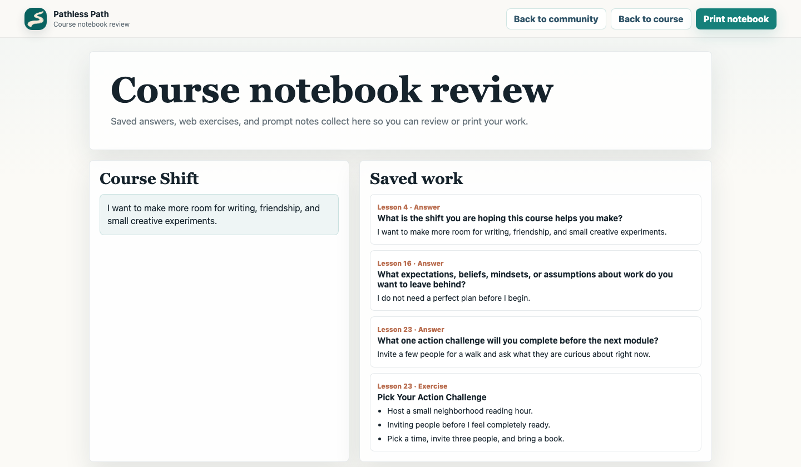

# Add a course portal

A course can share the community's member identity and sign-in flow. Give it its own curriculum, access rules, progress, and private notebook. Start with one course and a clear lesson page; add discussion, cohorts, or scheduled release only when they serve the learning experience.


The screenshots show the Reinvent interface, an actual course video, and fictional learner answers. Its notebook currently saves in browser local storage. The guide below recommends server storage for cross-device use and access checks for protected media. [More screenshots and capture notes](screenshots.md).

## 1. Decide who gets access

Choose whether a course is included with community membership, sold separately, gifted, or publicly available. Represent the decision in explicit entitlements. For example, `course:small-experiments` can be granted by a purchase or a manual gift. Keep the sources separate so cancelling one does not erase another valid grant.

Reuse the existing session and canonical member ID. Do not create a second account just because someone buys a course, or grant access because the browser returns from checkout. Verified billing events or audited manual grants should create access. Resolve any changed email addresses through verified account linking.

## 2. Try the optional schema locally

From the repository root, run a synthetic community import, apply the course extension, and load the fictional curriculum:

```bash
python3 scripts/import_circle.py \
  --export-dir examples/circle-export \
  --db private/course-rehearsal.sqlite \
  --community-key example-community

sqlite3 private/course-rehearsal.sqlite < schema/courses.sql
sqlite3 private/course-rehearsal.sqlite < examples/course-portal/seed.sql

sqlite3 private/course-rehearsal.sqlite \
  "select c.title, l.title from courses c join course_lessons l on l.course_id = c.id;"
```

The importer creates the base community schema. The extension adds:

| Table | Purpose |
| --- | --- |
| `courses` | Course title, publication state, and required entitlement key |
| `course_modules` | Ordered curriculum sections |
| `course_lessons` | Stable lesson IDs, content, publication state, and server-only media references |
| `course_progress` | Per-member resume position and completion |
| `course_notes` | Private answers per member, lesson, and prompt |

Keep IDs stable when you rename or reorder a lesson. The composite module relationship prevents a lesson from pointing at another course's module. Revision fields support optimistic concurrency; your API must enforce the revision checks. The SQL schema alone does not implement authorization.

Grant the synthetic learner access in the rehearsal database:

```sql
INSERT INTO member_entitlements
  (id, member_id, entitlement_key, source, status)
SELECT 'demo-course-grant', id, 'course:small-experiments', 'manual:demo', 'active'
FROM members WHERE email = 'avery@example.test'
ON CONFLICT(member_id, entitlement_key, source) DO NOTHING;
```

For a new D1 destination, apply `schema/community.sql` and `schema/courses.sql` first, then import the reviewed data. Existing deployments should adopt the extension through a numbered migration, following the [migration and recovery practices](best-practices.md#rehearse-database-changes-and-recovery).

The exporter includes course tables only when requested, because they can contain private learner answers:

```bash
python3 scripts/export_d1_sql.py \
  --db private/course-rehearsal.sqlite \
  --out private/course-rehearsal-d1.sql \
  --include-courses
```

This is a fresh-destination data export, not a live synchronization service or a complete backup. Keep real course exports private. Use a full database backup plus a media inventory for recovery.

## 3. Build a small server API

These are suggested endpoints to implement, not routes supplied by this repository.

| Endpoint | Responsibility |
| --- | --- |
| `GET /api/courses` | Return allowed catalog metadata and the signed-in member's access state |
| `GET /api/courses/:courseId/lessons/:lessonId` | Check publication, membership of the requested course, and entitlement before returning lesson content |
| `POST /api/courses/:courseId/lessons/:lessonId/playback` | Recheck access and issue a short-lived media token |
| `PUT /api/course-progress/:lessonId` | Save only the session member's progress; validate position and expected revision |
| `PUT /api/course-notes/:lessonId/:promptKey` | Save only the session member's answer; enforce size limits and expected revision |
| `GET /api/course-notebook/:courseId` | Return only that member's answers for the course |
| `GET /api/course-notebook/:courseId/export` | Download that member's notebook in a portable format |

Every content or playback request must authorize the course and lesson. A bound SQL lookup can express the access rule:

```sql
SELECT l.id, l.title, l.kind, l.body_markdown
FROM course_lessons l
JOIN courses c ON c.id = l.course_id
WHERE l.id = ? AND c.id = ?
  AND l.published = 1 AND c.published = 1
  AND EXISTS (
    SELECT 1 FROM member_entitlements e
    WHERE e.member_id = ?
      AND e.entitlement_key = c.entitlement_key
      AND e.status = 'active'
      AND (e.starts_at IS NULL OR julianday(e.starts_at) <= julianday('now'))
      AND (e.ends_at IS NULL OR julianday(e.ends_at) > julianday('now'))
  );
```

Bind the last parameter from the verified session, never a client-supplied member ID. Validate entitlement dates when writing them. Use a separate, explicit policy for public preview lessons. For notebook reads and writes, also filter by the session member ID. A UUID and an unlisted URL are not access controls.

## 4. Protect lessons, videos, and downloads

Keep paid lesson bodies, downloads, and private media references out of public HTML/JavaScript bundles and public buckets. Serve protected content through authorized endpoints. Route middleware is useful only if direct asset requests actually pass through it; check [Workers asset routing](https://developers.cloudflare.com/workers/static-assets/routing/worker-script/).

For video, use a service designed for streaming. With Mux, configure a signed playback policy and generate short-lived playback tokens on the server after checking access. Never ship the signing key to the browser. See [Mux secured playback](https://www.mux.com/docs/guides/secure-video-playback). Cloudflare Stream is another option; require signed URLs and generate tokens after the same authorization check. See [Stream access controls](https://developers.cloudflare.com/stream/viewing-videos/securing-your-stream/).

For private downloads in R2, keep the bucket private and authorize each request before streaming the object or issuing a short-lived download URL. Do not store expiring URLs as curriculum data; store an object key or provider asset reference. Mark token and private-data responses `private, no-store`. Origin restrictions reduce hotlinking; they do not replace entitlement checks. Signed URLs limit access, but they cannot prevent an authorized viewer from recording a video.

## 5. Make progress and notes dependable

Keep the interface simple: module navigation, lesson content, one clear next action, and a notebook. Save text with a short debounce and an explicit saved/error state. A failed request must leave the answer available for retry. On a revision conflict, preserve the local draft and ask the learner to reconcile it rather than silently overwriting another device's work.

Use server storage for cross-device progress and answers. Browser storage can hold an optional local draft; it can be cleared and is not a backup. Namespace local drafts by member, clear them on logout or account switch, and never put session tokens there. A shared browser must not show the previous learner's notebook.

Exercises can store structured choices as well as free text. For a values inventory, save stable value IDs, the personal/work category, and the learner's reflections. Let people change their choices and return to them later.


Keep answers private by default. Exclude them from the weekly digest, directory, marketing, and analytics. Sharing a reflection with the community should be a separate member action. Decide how notebook export remains available after paid access expires; access revocation and deletion of a person's writing are different operations.



## 6. Migrate a course without losing people

Inventory lessons, module order, video/audio originals, transcripts, captions, downloads, enrollments, purchase records, progress, and student writing separately. Import only content you have permission to host. Map old lesson IDs to stable new IDs, reconcile enrollments against billing/manual grants, and preserve the source files privately.

Try the new portal with a few test accounts before switching links. Check an active learner, a gifted learner, someone with expired access, and an unknown visitor. Keep the old platform available until access and content are verified, and give learners a clear way to report a missing lesson or purchase.

## 7. Verify before launch

- Signed-out visitors and members without the right entitlement cannot fetch paid lesson bodies, downloads, or playback tokens, including by direct URL.
- Expired or revoked grants stop access; another independent valid grant still works.
- Repeated payment events create one grant. Delayed payments and refunds follow your stated policy.
- A member cannot read or write another member's notes, even by changing request parameters.
- Progress survives a reload and a second device; offline saves and revision conflicts are recoverable.
- Notebook export and deletion work, and a backup can be restored without losing the relationship between lessons and answers.
- The lesson page works on a phone and with a keyboard; media has captions/transcripts and exercises have accessible controls.

Test these flows with fictional learners before importing real enrollments.
