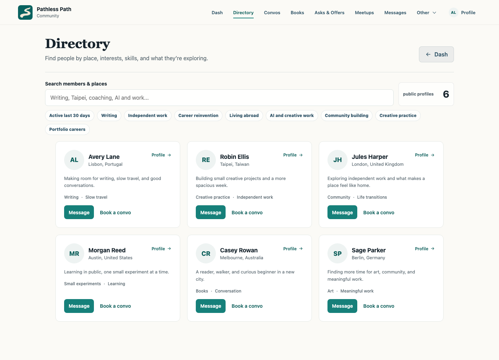
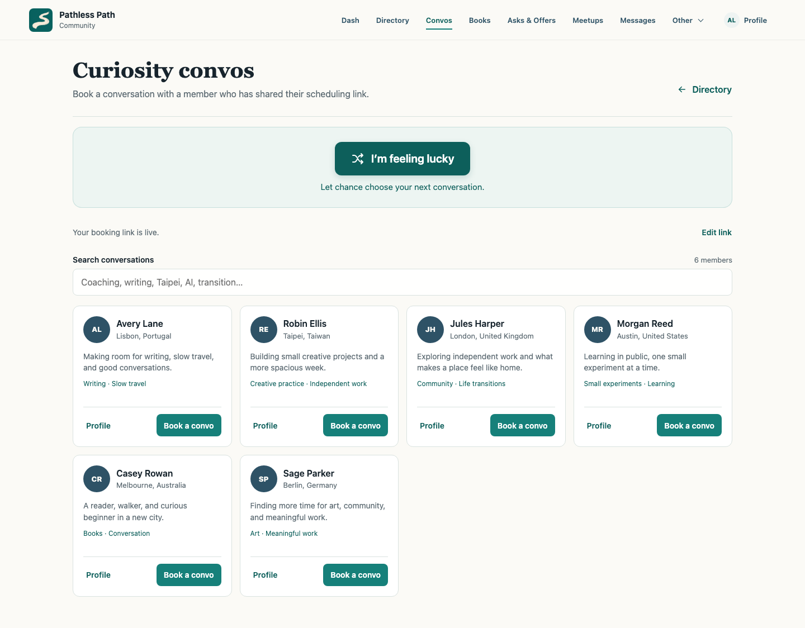
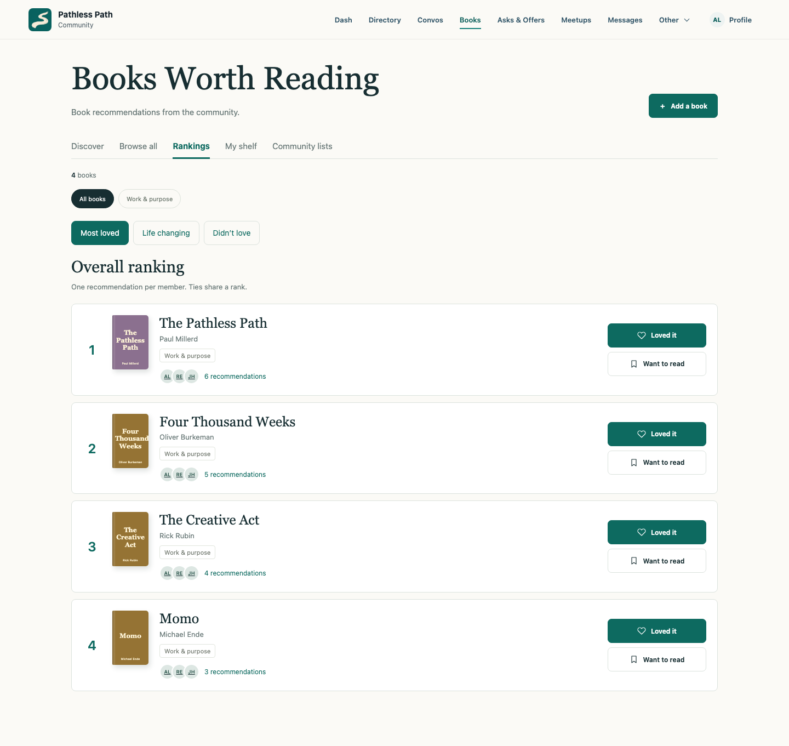
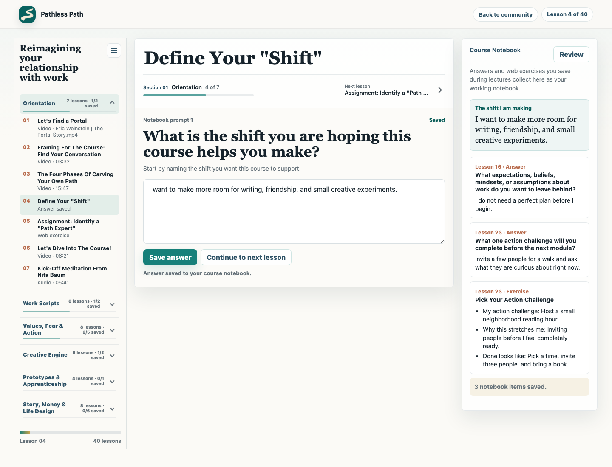
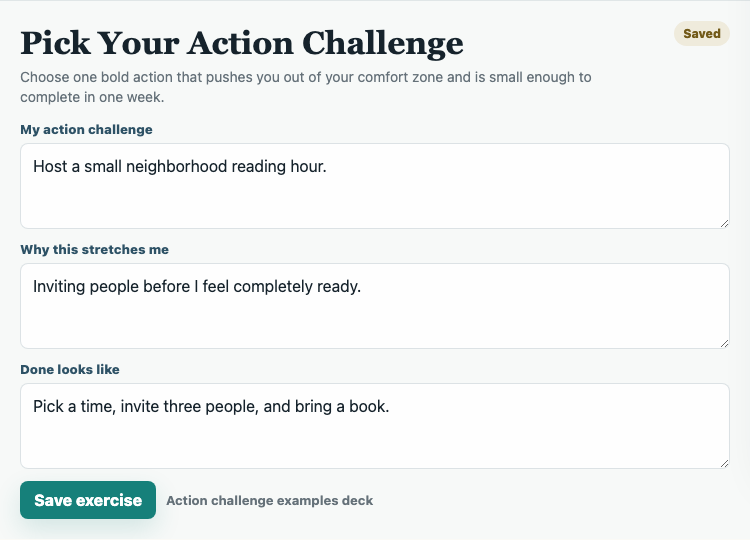

# Community and course screenshots

These images show the Pathless Path interface. All member profiles, messages, activity, recommendations, and learner answers were created for the examples. Paul supplied the map screenshot, which shows aggregate locations without member names. The course video is an actual Reinvent lesson.

## Weekly community email

The letter brings together things members might want to follow up on: a new neighbor, an event, a project, or an offer to talk. This example uses the actual email template with fictional content. [How the weekly letter works](weekly-member-signals.md).

## Homepage feed

Recent activity sits beside suggested people and upcoming gatherings. Members can go straight from an update to a profile, message, or event.

## Direct messages

A private conversation can start with something noticed in the email or feed. The example messages were written for this capture.

## Profile wall

Members can leave a message on someone's profile for the community to see.

## Member map

Browse shared locations by city or explore clusters on the map. This is the image Paul supplied for publication, reproduced unchanged. It includes a tile-loading notice from the captured session.

## Member directory

Find people by place, interests, and what they are exploring. Open a profile, send a message, or book a conversation.

## Curiosity conversations

Members share a scheduling link and topics they would enjoy talking about. A random suggestion gives someone a place to start.

## Shared bookshelf

The titles and authors are real; the recommendations and counts are invented. Book covers use the interface's text placeholders.

## Course video

An actual Reinvent lesson plays beside the module navigation and learner notebook. The written answer is fictional.

## Values exercise

Choose values for personal and working life, then reflect on the choices. The full course layout keeps the module navigation and notebook alongside the exercise.

## Course reflection

Lesson navigation, a prompt, and the learner's notebook sit together. This earlier capture focuses on the written reflection, with video disabled.

## Action challenge

A saved exercise turns an idea into something the learner can try.

## Notebook review

Saved answers and exercises come together so a learner can return to them or print their work.

## Capture notes

Captured on 14 October 2026. The local interface captures used an isolated Chromium context. The email was rendered from the existing template. Paul's supplied map image was copied unchanged.

- Every local API response was replaced with a fictional fixture. No production account, member database, session cookie, or sign-in link was used.
- Browser storage started fresh and contained only fictional course answers. Names, locations, profile text, messages, scheduling URLs, counts, and recommendations were invented.
- External requests were blocked except the player and Mux media needed to show the course video. Member images and course downloads were not served. The separately loaded lesson-source script was disabled.
- The email links point to `example.test`. The capture does not contain a recipient list, personal sign-in links, or a production send. A real edition also includes preference and unsubscribe controls.
- The supplied map contains aggregate counts and approximate locations, including Paul's own map marker. No member names, contact details, or profile writing appear. The map's provider attribution remains visible.
- Presentation styles kept type upright and removed decorative labels from the generated captures. Functional navigation, form labels, and save controls remain.
- The rendered images were inspected for personal information and clipped content. The course screenshots illustrate the interface; the [course guide](course-portal.md) explains the recommended server storage and media access checks.

For your own captures, use a fresh browser, fictional responses, a narrow asset allowlist, and a visual check before publishing. Keep any real exports or source records outside the public repository.
